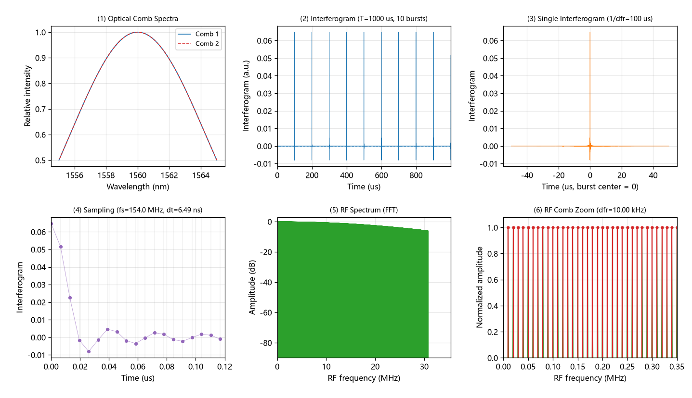

# 双光梳时域采样分析系统

一个**单文件** Python GUI，用于可视化双光梳（dual-comb）下变频链路：
**光梳频率控制 → 时域采样 → 时域干涉图 → 射频频谱图**。

> A single-file Python GUI that visualizes the dual-comb down-conversion chain:
> comb frequency control → time-domain sampling → interferogram → RF spectrum.


英文界面版本（`dual_comb_analysis_en.py`）：



## 功能

- **光梳频率控制**：中心波长 λc、光谱带宽（强度FWHM）、重复频率 fr1/fr2、fceo1/fceo2 可分别设置
- **时域采样**：记录时长 T；采样率 fs 可自动（取 Δfr 的整数倍，使每个干涉图采样点数为整数、可整齐切片）或手动
- **干涉图**：全记录时域干涉图（1 ms 内 10 个 burst）+ 单个干涉图（1/Δfr 切片，burst 居中）
- **射频频谱图**：干涉图 FFT 的 dB 全貌 + RF 梳齿放大段（可分辨 Δfr 齿距）
- **交互**：鼠标滚轮缩放当前子图、双击复位，另带 matplotlib 工具栏（框选缩放/平移/Home/保存）

六个子图依次为：① 双光梳光学梳谱　② 全记录时域干涉图　③ 单个干涉图　④ 时域采样细节　⑤ 射频频谱图　⑥ RF 梳齿放大

## 物理模型

第 p 根齿的光学频率：

```
f1p = fc + p·fr1        f2p = fc + p·fr2
```

平方律探测后的下变频拍频（RF 频率）：

```
f_RF = p·Δfr + Δfceo     Δfr = fr2 − fr1,  Δfceo = fceo2 − fceo1
```

时域干涉图与 RF 谱：

```
I(t) = Σ_p I_env(f_p)·cos(2π·f_RF·t)
RF 谱 = FFT[ I(t) ]
```

由此得到两条常用结论：

```
干涉图周期     = 1/Δfr
RF 带宽(下变频) ≈ B_opt · Δfr / fr        （B_opt 为光谱带宽）
RF 梳齿间隔     = Δfr
```

**默认参数下的核对值**（λc=1560 nm、带宽10 nm、fr1=200 MHz、fr2=200.01 MHz、fceo=0、T=1 ms）：

| 量 | 值 |
| --- | --- |
| 中心频率 | 192.1747 THz |
| 强度FWHM带宽 | 1.232 THz（10 nm） |
| 光学梳齿数 | 6161（半宽 P=3080） |
| Δfr | 0.0100 MHz = 10.000 kHz |
| 干涉图周期 | 100.0 μs（1 ms 内 10 个 burst） |
| RF 带宽 | 30.80 MHz |
| 映射比 Δfr/fr | 5.000×10⁻⁵ |
| 自动采样率 fs | 154.000 MHz（N=154000，每干涉图 15400 点） |
| RF 分辨率 | 1.00 kHz |

## 安装与运行

```bash
pip install -r requirements.txt      # numpy、matplotlib
python 双光梳分析系统.py              # 中文界面
python dual_comb_analysis_en.py       # 英文界面
```

- 需要带 `tkinter` 的 Python。Windows 官方安装包默认自带；Linux 若缺失可 `sudo apt install python3-tk`。
- 已验证环境：Windows + Python 3.12.10 + numpy 2.5.0 + matplotlib 3.11.0（Tk 8.6）。
- 中文界面会自动寻找系统中文字体（Microsoft YaHei / SimHei / SimSun / Noto Sans CJK 等）；非 Windows 机器若无中文字体，请安装一个或改用英文版。

## 参数说明

| 参数 | 默认值 | 说明 |
| --- | --- | --- |
| 中心波长 λc | 1560 nm | 决定光梳中心频率 fc |
| 光谱带宽 | 10 nm | 按强度 FWHM 处理，决定齿数与 RF 带宽 |
| 重复频率 fr1 | 200 MHz | 光梳1重复频率 |
| 重复频率 fr2 | 200.01 MHz | 光梳2重复频率（默认 +10 kHz） |
| fceo1 / fceo2 | 0 / 0 MHz | 载波包络偏移频率，可分别设置 |
| 记录时长 T | 1 ms | 时域记录长度 |
| 采样率 fs | 154 MHz（自动） | 自动时取 Δfr 整数倍并预填该值，可手动覆盖 |
| 自动采样率 | 勾选 | 使 fs/Δfr 为整数，切片整齐 |

## 使用提示

- **缩放**：在某个子图上滚动鼠标滚轮缩放该子图（以光标为中心），双击复位；工具栏可框选放大、平移、保存图片。
- **低采样率混叠**：手动把 fs 设到低于 Nyquist（2×RF带宽）时，右侧信息栏会给出混叠警告，例如 fs=50 MHz 时提示 `aliasing=True`。
- **看齿**：⑤ 是全貌（齿很密时会连成一片），⑥ 已放大到 0–0.35 MHz；要更细可滚轮放大后逐段观察。
- **规模上限**：采样点 N 超过 12,000,000 会拒绝计算并提示减小 T 或 fs。

## 文件结构

```
.
├── 双光梳分析系统.py          # 中文界面（图内中文，自动选中文字体）
├── dual_comb_analysis_en.py   # 英文界面（图内全英文，无字体依赖问题）
├── requirements.txt
├── docs/
│   ├── screenshot_zh.png
│   └── screenshot_en.png
├── LICENSE
└── README.md
```

两个脚本的物理与功能完全一致，仅界面与图内文字语言不同。

## 已知限制

- 这是**正演演示模型**：不含激光噪声、气体吸收线、色散与载波相位，不用于处理实测数据。
- 采用"频域按共轭对称放置齿列 → ifft"合成时域信号，等价于下变频干涉图的快速生成，并非逐齿积分真实光谱。
- 单干涉图的 FFT 频率间隔恰为 Δfr，因此可分辨的梳齿谱图必须用**全记录** FFT 再放大一段（见 ⑥）。
- 计算量随 N 增长，长时间记录会变慢。

## 参考与致谢

- 参考项目：**Dual-Comb Toolkit**（Bernat Frangi，MIT License，DOI: 10.5281/zenodo.18040669）——本项目与其在"按 1/Δfr 切片、RF↔光学映射比例 Δfr/fr"的约定上一致，但代码为独立实现。
  <https://github.com/bfrangi/dual-comb-toolkit>
- 双光梳下变频与时域干涉图定义：I. Coddington, N. Newbury, W. Swann, *Optica* **3**, 414 (2016). <https://doi.org/10.1364/OPTICA.3.000414>

## 许可证

[MIT](LICENSE)

## 引用

```bibtex
@software{dual_comb_analysis_gui,
  title  = {Dual-Comb Time-Domain Analysis GUI},
  author = {KeYin},
  year   = {2026},
  note   = {Single-file Python GUI for dual-comb down-conversion visualization}
}
```
